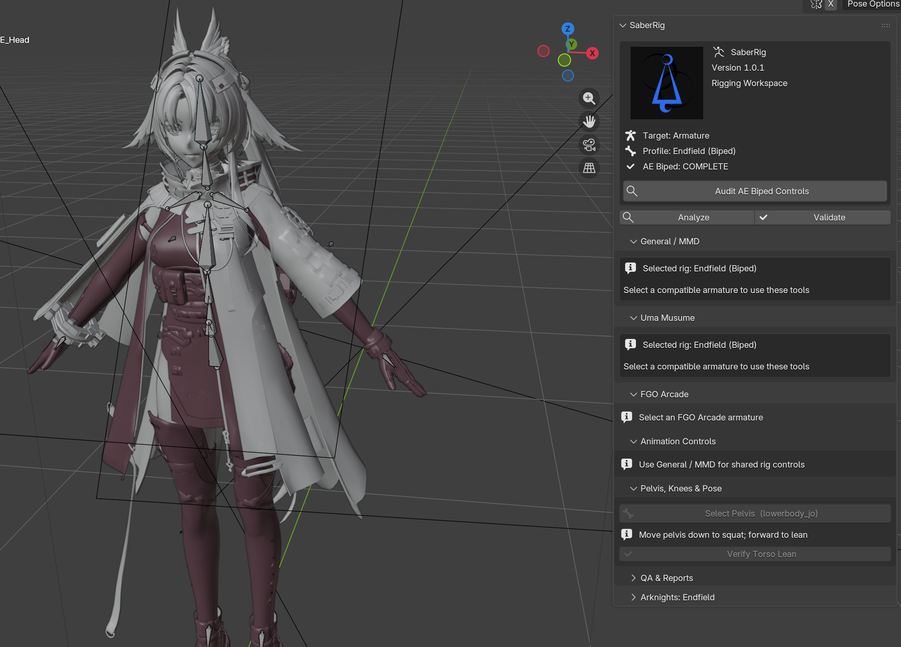
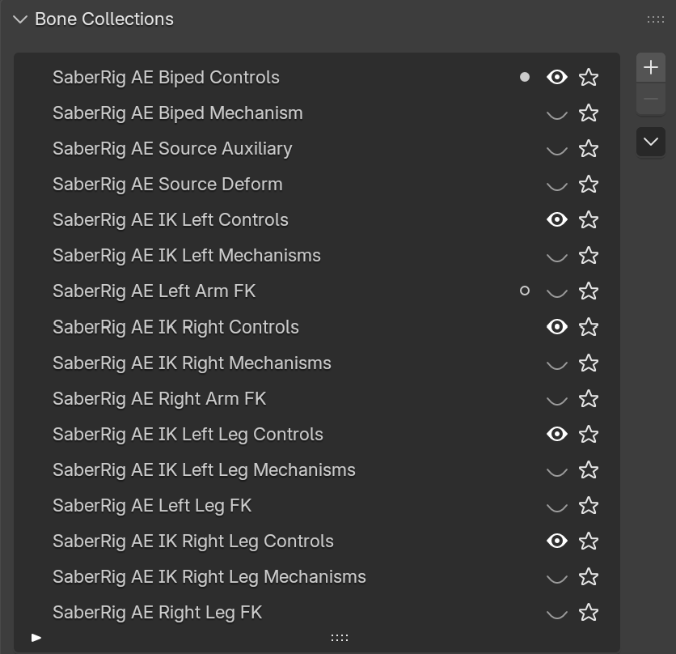
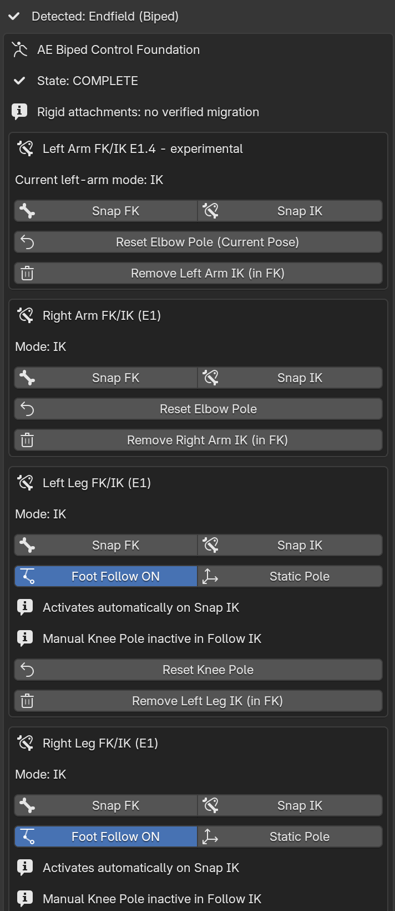
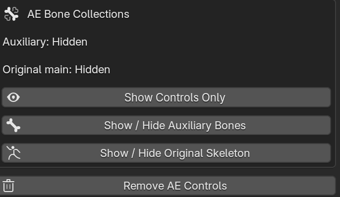

  
  <h1>SaberRig</h1>
  
<strong>Profile-based character rigging and animation controls for Blender</strong>

  
Rigging de personajes y controles de animación por perfiles para Blender

  
<strong>Current release: 1.0.5</strong> · <strong>Designed for Blender 5.1.1+</strong>

English · Español · Visual guide / Guía visual · Releases · Report an issue
Profile recognition relies on the armature's structure and bone names. A visible profile does not mean every imported model of that game is automatically supported. Check the analysis and validation results before animating.
Requirements and compatibility
- Blender 5.1.1 is the project's development target. Other versions have not been universally validated.
- An imported model with an armature and usable deformation bones. A suitable hierarchy and bone naming are important for specialized profiles.
- A saved backup of your .blend file before preparing, rebuilding, removing or switching rig controls.
- For certain profiles, additional source-specific bone structures or helper bones may be required. SaberRig does not download or provide character assets.

Names such as Uma Musume, Fate/Grand Order Arcade, and Arknights: Endfield describe intended workflows only. SaberRig is an independent community project and is not affiliated with or endorsed by the rights holders of those games.
Known limitations and bug reports
- Automatic profile detection and bone mapping are not universal. Custom or modified skeletons may require manual work and may be incompatible with specialized operators.
- Some FGO Arcade and Endfield behaviors have been validated on a limited set of source rigs; other characters require their own tests.
- Some Endfield limb IK/FK options are explicitly marked experimental in the interface.
- A successful preparation or audit does not replace visual inspection of deformation and animation.
Found a problem? Open a GitHub issue with your Blender and SaberRig versions, the selected profile, reproduction steps, expected/actual results, relevant console messages, and screenshots where useful. Do not upload copyrighted game assets without permission.
License and credits
SaberRig is maintained by XDZR8. The repository provides the GNU General Public License v3.0 (GPL-3.0) in its LICENSE file. Any third-party files or assets must retain their applicable notices and licenses.

Español

SaberRig no distribuye personajes, armatures, mallas, texturas, animaciones ni otros recursos extraídos de videojuegos que pertenezcan a terceros. Los usuarios deben aportar únicamente recursos que tengan autorización para utilizar.

Los nombres Uma Musume, Fate/Grand Order Arcade y Arknights: Endfield identifican flujos de trabajo previstos. SaberRig es un proyecto comunitario independiente y no está afiliado ni respaldado por los titulares de esos juegos.
Limitaciones conocidas y reporte de errores
- La detección de perfiles y la asignación de huesos no son universales. Los esqueletos personalizados o modificados pueden requerir intervención manual y no ser compatibles con algunos operadores.
- Algunas funciones de FGO Arcade y Endfield se han comprobado con un conjunto limitado de modelos; otros personajes necesitan validación propia.
- Algunas opciones FK/IK de Endfield figuran expresamente como experimentales.
- Una preparación o auditoría satisfactoria no sustituye la comprobación visual de la deformación y la animación.
¿Has encontrado un error? Abre una incidencia en GitHub e indica la versión de Blender y SaberRig, el perfil elegido, los pasos para reproducirlo, el resultado esperado y real, los errores de consola relevantes y capturas si ayudan. No subas recursos de videojuegos protegidos sin permiso.
Licencia y créditos
SaberRig está mantenido por XDZR8. El repositorio incluye la Licencia Pública General de GNU, versión 3.0 (GPL-3.0) en LICENSE. Los archivos y recursos de terceros deben conservar los avisos y licencias que les correspondan.

Visual guide / Guía visual
The following screenshots are included in the repository under [`assets/branding/`](./assets/branding/). They illustrate the interface and rigging workflows; actual controls depend on the detected profile and the source armature.

Las siguientes capturas están incluidas en [`assets/branding/`](./assets/branding/). Ilustran la interfaz y los flujos de rigging; los controles disponibles dependen del perfil detectado y del armature original.

1. Interface and model view / Interfaz y vista del modelo

  

EN: Main SaberRig panel: where to inspect the available profile sections and start the compatible workflow.
ES: Panel principal de SaberRig: dónde consultar los perfiles disponibles e iniciar el flujo compatible.

  

EN: Example of SaberRig being used with an imported character.
ES: Ejemplo de SaberRig con un personaje importado.

2. Armature and bone organization / Armature y organización de huesos
Armature Display / Visualización del armature	Bone Collections / Colecciones de huesos
	

EN: Examples of armature display and bone collection organization. These tools improve visibility and navigation; they do not imply that all bones are compatible with every rig profile.
ES: Ejemplos de visualización del armature y organización de colecciones de huesos. Ayudan a localizar controles, pero no garantizan que todos los huesos sean compatibles con cualquier perfil.

3. Uma Musume
Uma Musume panel / Panel	Prepared rig / Rig preparado
	

EN: Compare the profile-specific tools with an example of the resulting rig controls. Exact options depend on the model's bone hierarchy.
ES: Compara las herramientas específicas del perfil con un ejemplo de los controles del rig. Las opciones disponibles dependen de la jerarquía de huesos del modelo.

4. Fate/Grand Order Arcade
FGO Arcade panel / Panel	Prepared rig / Rig preparado
	

EN: Example of the FGO preparation interface and the rig used for posing and animation, including supported FK/IK workflows.
ES: Ejemplo de la preparación FGO y del rig destinado a poses y animación, incluidos los flujos FK/IK compatibles.

5. Arknights: Endfield

  

EN: Overview of the Endfield biped rig setup. The full biped toolset is not automatically available for segmented or otherwise incompatible source rigs.
ES: Vista general de los controles del rig bípedo de Endfield. Las herramientas completas del bípedo no se aplican automáticamente a rigs segmentados o incompatibles.
IK controls / Controles IK	Bone visibility / Visibilidad de huesos
	

EN: Examples of IK-related controls and options to show or hide bones. Check deformation and FK/IK transitions before using a new character in production.
ES: Ejemplos de controles IK y opciones para mostrar u ocultar huesos. Comprueba las deformaciones y las transiciones FK/IK antes de utilizar un personaje nuevo en producción.
Asset note / Nota sobre recursos: The screenshots are documentation examples and are not included as licensed game assets for reuse. SaberRig does not ship the character models depicted. / Las capturas son ejemplos de documentación y no autorizan reutilizar recursos de videojuegos. SaberRig no distribuye los modelos representados.
