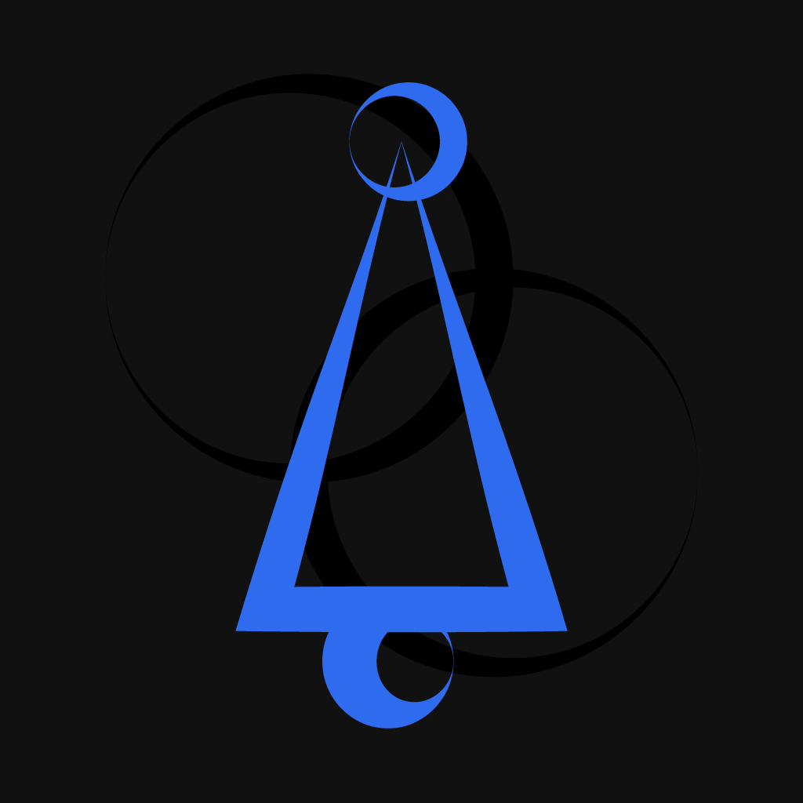
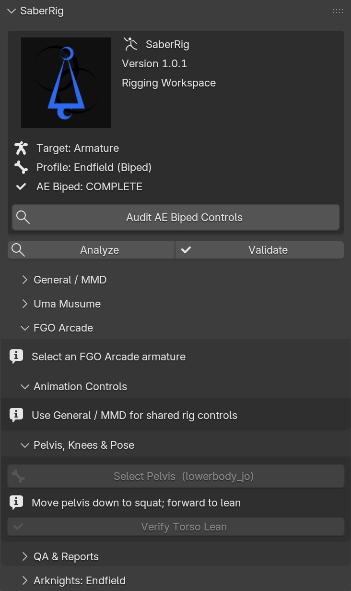
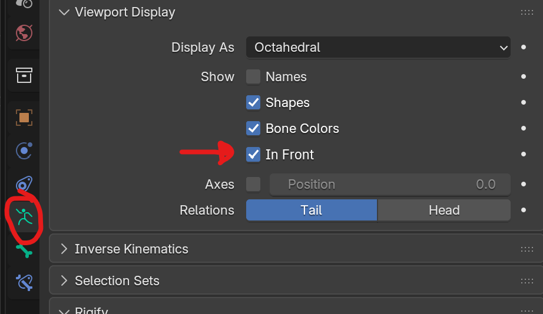
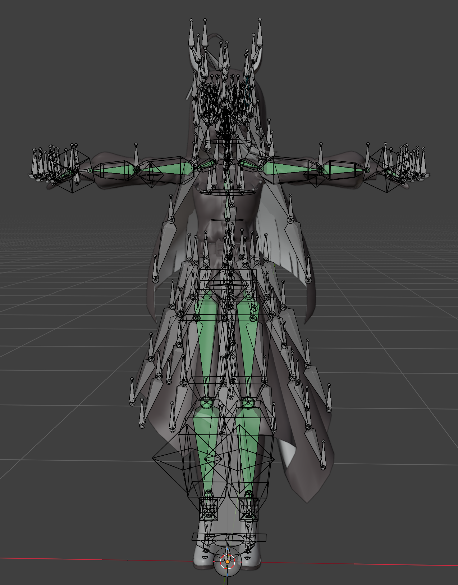
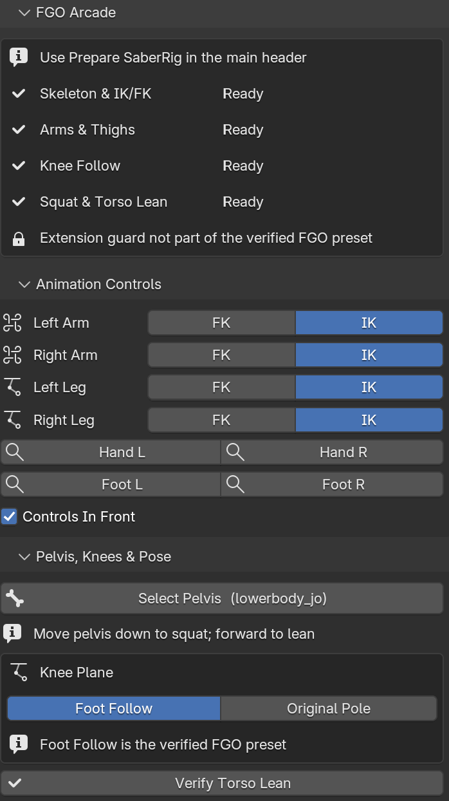

  
  <h1>SaberRig</h1>
  
<strong>Profile-based character rigging and animation controls for Blender</strong>

  
Rigging de personajes y controles de animación por perfiles para Blender

  
<strong>Current release: 1.0.5</strong> · <strong>Designed for Blender 5.1.1+</strong>

**[English](#english)** · **[Español](#español)** · **[Visual guide / Guía visual](#visual-guide)** · **[Releases](https://github.com/XDZR8/SaberRig/releases)** · **[Report an issue](https://github.com/XDZR8/SaberRig/issues/new)**

  

<em>SaberRig interface / Interfaz de SaberRig</em>

---

## English

### What is SaberRig?

SaberRig is a Blender add-on that prepares and enhances character armatures with profile-based controls for posing and animation. It detects compatible bone hierarchies and provides tools tailored to specific source workflows.

**Available profiles in version 1.0.5:**

| Profile | Intended workflow |
| --- | --- |
| **Uma Musume** | Profile-specific preparation, control setup and animation-oriented tools based on the source armature structure. |
| **Fate/Grand Order Arcade** | Preparation, FK/IK workflows, bone organization and controls validated on supported source rigs. |
| **Arknights: Endfield** | Biped-oriented tools, IK options (some experimental), bone visibility helpers and related controls. |

Profile recognition relies on the armature’s structure and bone names. A visible profile does **not** mean every imported model of that game is automatically supported. Always check the analysis and validation results before animating.

### Requirements and compatibility

- **Blender 5.1.1** is the project’s development target. Other versions have not been universally validated.
- An imported model with an armature and usable deformation bones. A suitable hierarchy and bone naming are important for specialized profiles.
- A saved backup of your `.blend` file before preparing, rebuilding, removing or switching rig controls.
- For certain profiles, additional source-specific bone structures or helper bones may be required. SaberRig does **not** download or provide character assets.

### Installation

1. Open the **[SaberRig releases page](https://github.com/XDZR8/SaberRig/releases)** and download the **installable add-on package** (latest current version).
2. Launch Blender and open **Edit → Preferences**.
3. In **Get Extensions** or **Add-ons**, open the top-right menu and choose **Install from Disk**.
4. Select the downloaded add-on ZIP. Keep the package zipped during installation.
5. Enable **SaberRig** if it is not already enabled.
6. Return to the **3D Viewport**, press **N** to open the sidebar, and select the **SaberRig** tab.

### Basic usage

1. Import your model and make sure the armature is present and selectable.
2. Select the armature (or the character object that owns it) and open the SaberRig panel.
3. Review the detected profile and the analysis / validation results.
4. Run the preparation / build operators for the selected profile.
5. Inspect the resulting controls, bone collections and visibility options. Test deformation and FK/IK transitions before production use.

**Important:** Preparation and rebuild tools can modify the armature, constraints and scene organization. Always work on a saved copy when testing a new model. Exact results depend on the source bone hierarchy and profile support.

### What is not included

SaberRig does **not** distribute extracted game characters, armatures, meshes, textures, animations or any other copyrighted third-party assets. Users must supply their own assets and are responsible for having the necessary rights to use them.

Names such as Uma Musume, Fate/Grand Order Arcade and Arknights: Endfield describe intended workflows only. SaberRig is an independent community project and is not affiliated with, endorsed by or supported by the respective rights holders.

### Known limitations and bug reports

- Automatic profile detection and bone mapping are not universal. Custom or modified skeletons may require manual work and may be incompatible with specialized operators.
- Some FGO Arcade and Endfield behaviors have been validated on a limited set of source rigs; other characters require their own tests.
- Some Endfield limb IK/FK options are explicitly marked **experimental** in the interface.
- A successful preparation or audit does not replace visual inspection of deformation and animation.

Found a problem? **[Open a GitHub issue](https://github.com/XDZR8/SaberRig/issues/new)** and include your Blender and SaberRig versions, the selected profile, reproduction steps, expected/actual results, relevant console messages, and screenshots where useful. Do not upload copyrighted game assets without permission.

### License and credits

SaberRig is maintained by **XDZR8**. The repository provides the **GNU General Public License v3.0 (GPL-3.0)** in its `LICENSE` file. Any third-party files or assets must retain their applicable notices and licenses.

---

## Español

### ¿Qué es SaberRig?

SaberRig es un complemento de Blender que prepara y mejora armatures de personajes con controles orientados a pose y animación según perfiles. Detecta jerarquías de huesos compatibles y ofrece herramientas adaptadas a flujos de trabajo concretos.

**Perfiles disponibles en la versión 1.0.5:**

| Perfil | Uso previsto |
| --- | --- |
| **Uma Musume** | Preparación específica del perfil, controles y herramientas orientadas a animación según la estructura del armature de origen. |
| **Fate/Grand Order Arcade** | Preparación, flujos FK/IK, organización de huesos y controles validados en rigs de origen compatibles. |
| **Arknights: Endfield** | Herramientas orientadas a bípedos, opciones IK (algunas experimentales), helpers de visibilidad de huesos y controles relacionados. |

El reconocimiento de perfiles se basa en la estructura del armature y los nombres de los huesos. Que aparezca un perfil **no** significa que todos los modelos importados de ese juego estén soportados automáticamente. Revisa siempre los resultados del análisis y la validación antes de animar.

### Requisitos y compatibilidad

- **Blender 5.1.1** es el objetivo de desarrollo del proyecto. Otras versiones no han sido validadas de forma universal.
- Un modelo importado con armature y huesos de deformación utilizables. Una jerarquía y nombres de huesos adecuados son importantes para los perfiles especializados.
- Una copia de seguridad del archivo `.blend` antes de preparar, reconstruir, eliminar o cambiar controles del rig.
- En ciertos perfiles pueden ser necesarias estructuras de huesos o helper bones específicos del origen. SaberRig **no** descarga ni proporciona assets de personajes.

### Instalación

1. Abre la **[página de versiones de SaberRig](https://github.com/XDZR8/SaberRig/releases)** y descarga el **paquete instalable del complemento** (última versión actual).
2. Abre Blender y entra en **Edit → Preferences**.
3. En **Get Extensions** o **Add-ons**, abre el menú de la esquina superior derecha y selecciona **Install from Disk**.
4. Selecciona el ZIP descargado. No lo descomprimas durante la instalación.
5. Activa **SaberRig** si Blender no lo ha activado automáticamente.
6. Vuelve al **3D Viewport**, pulsa **N** para abrir la barra lateral y selecciona la pestaña **SaberRig**.

### Uso básico

1. Importa tu modelo y comprueba que el armature esté presente y sea seleccionable.
2. Selecciona el armature (o el objeto del personaje que lo contiene) y abre el panel de SaberRig.
3. Revisa el perfil detectado y los resultados del análisis / validación.
4. Ejecuta los operadores de preparación / construcción del perfil seleccionado.
5. Inspecciona los controles resultantes, las colecciones de huesos y las opciones de visibilidad. Prueba la deformación y las transiciones FK/IK antes de usarlo en producción.

**Importante:** las herramientas de preparación y reconstrucción pueden modificar el armature, las constraints y la organización de la escena. Trabaja siempre sobre una copia guardada al probar un modelo nuevo. Los resultados exactos dependen de la jerarquía de huesos de origen y del soporte del perfil.

### Qué NO incluye

SaberRig **no distribuye** personajes, armatures, mallas, texturas, animaciones ni otros recursos extraídos de videojuegos que pertenezcan a terceros. Los usuarios deben aportar únicamente recursos que tengan autorización para utilizar.

Los nombres Uma Musume, Fate/Grand Order Arcade y Arknights: Endfield identifican flujos de trabajo previstos. SaberRig es un proyecto comunitario independiente y no está afiliado ni respaldado por los titulares de esos juegos.

### Limitaciones conocidas y reporte de errores

- La detección de perfiles y la asignación de huesos no son universales. Los esqueletos personalizados o modificados pueden requerir intervención manual y no ser compatibles con algunos operadores.
- Algunas funciones de FGO Arcade y Endfield se han comprobado con un conjunto limitado de modelos; otros personajes necesitan validación propia.
- Algunas opciones FK/IK de Endfield figuran expresamente como **experimentales**.
- Una preparación o auditoría satisfactoria no sustituye la comprobación visual de la deformación y la animación.

¿Has encontrado un error? **[Abre una incidencia en GitHub](https://github.com/XDZR8/SaberRig/issues/new)** e indica la versión de Blender y SaberRig, el perfil elegido, los pasos para reproducirlo, el resultado esperado y real, los errores de consola relevantes y capturas si ayudan. No subas recursos de videojuegos protegidos sin permiso.

### Licencia y créditos

SaberRig está mantenido por **XDZR8**. El repositorio incluye la **Licencia Pública General de GNU, versión 3.0 (GPL-3.0)** en `LICENSE`. Los archivos y recursos de terceros deben conservar los avisos y licencias que les correspondan.

---

## Visual guide / Guía visual

*The following screenshots are included in the repository under `assets/branding/`. They illustrate the interface and rigging workflows; actual controls depend on the detected profile and the source armature.*

*Las siguientes capturas están incluidas en `assets/branding/`. Ilustran la interfaz y los flujos de rigging; los controles disponibles dependen del perfil detectado y del armature original.*

<strong>1. Interface and model view / Interfaz y vista del modelo</strong>

  

**EN:** Main SaberRig panel — where to inspect the available profile sections and start the compatible workflow.  
**ES:** Panel principal de SaberRig — dónde consultar los perfiles disponibles e iniciar el flujo compatible.

  

**EN:** Example of SaberRig being used with an imported character.  
**ES:** Ejemplo de SaberRig con un personaje importado.

<strong>2. Armature and bone organization / Armature y organización de huesos</strong>

| Armature Display / Visualización del armature | Bone Collections / Colecciones de huesos |
| --- | --- |
|  |  |

**EN:** Examples of armature display and bone collection organization. These tools improve visibility and navigation; they do not imply that all bones are compatible with every rig profile.  
**ES:** Ejemplos de visualización del armature y organización de colecciones de huesos. Ayudan a localizar controles, pero no garantizan que todos los huesos sean compatibles con cualquier perfil.

<strong>3. Uma Musume</strong>

| Uma Musume panel / Panel | Prepared rig / Rig preparado |
| --- | --- |
|  |  |

**EN:** Compare the profile-specific tools with an example of the resulting rig controls. Exact options depend on the model’s bone hierarchy.  
**ES:** Compara las herramientas específicas del perfil con un ejemplo de los controles del rig. Las opciones disponibles dependen de la jerarquía de huesos del modelo.

<strong>4. Fate/Grand Order Arcade</strong>

| FGO Arcade panel / Panel | Prepared rig / Rig preparado |
| --- | --- |
|  |  |

**EN:** Example of the FGO preparation interface and the rig used for posing and animation, including supported FK/IK workflows.  
**ES:** Ejemplo de la preparación FGO y del rig destinado a poses y animación, incluidos los flujos FK/IK compatibles.

<strong>5. Arknights: Endfield</strong>

  

**EN:** Overview of the Endfield biped rig setup. The full biped toolset is not automatically available for segmented or otherwise incompatible source rigs.  
**ES:** Vista general de los controles del rig bípedo de Endfield. Las herramientas completas del bípedo no se aplican automáticamente a rigs segmentados o incompatibles.

| IK controls / Controles IK | Bone visibility / Visibilidad de huesos |
| --- | --- |
|  |  |

**EN:** Examples of IK-related controls and options to show or hide bones. Check deformation and FK/IK transitions before using a new character in production.  
**ES:** Ejemplos de controles IK y opciones para mostrar u ocultar huesos. Comprueba las deformaciones y las transiciones FK/IK antes de utilizar un personaje nuevo en producción.

---

**Asset note / Nota sobre recursos:**  
The screenshots are documentation examples and are not included as licensed game assets for reuse. SaberRig does not ship the character models depicted.  
Las capturas son ejemplos de documentación y no autorizan reutilizar recursos de videojuegos. SaberRig no distribuye los modelos representados.
