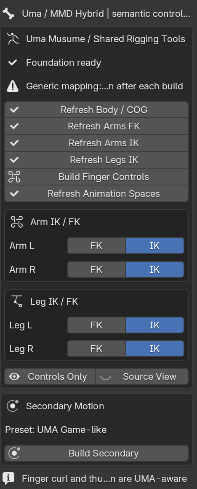
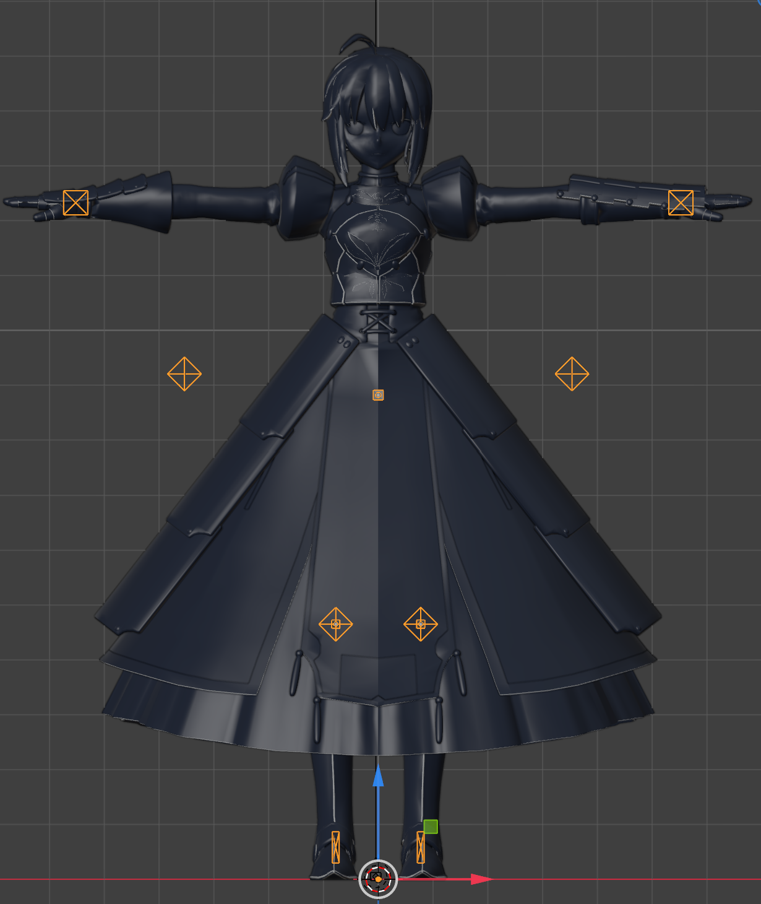
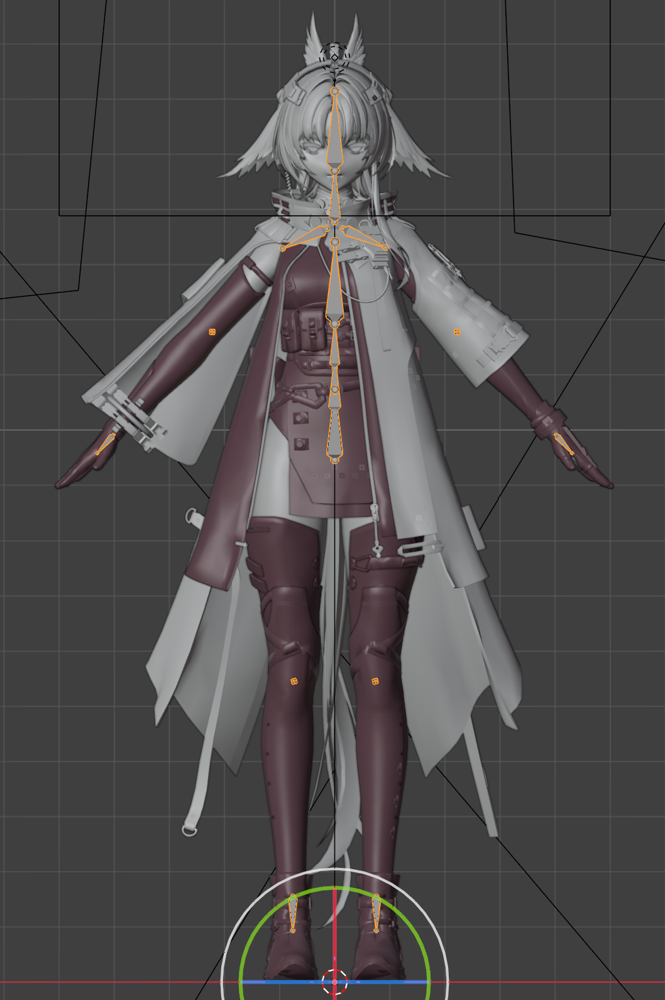

  
  <h1>SaberRig</h1>
  
<strong>Profile-based character rigging and animation controls for Blender</strong>

  
Rigging de personajes y controles de animación por perfiles para Blender

  
<strong>Current release: 1.0.5</strong> · <strong>Designed for Blender 5.1.1+</strong>

English · Español · Visual guide / Guía visual · Releases · Report an issue
Visual examples / Ejemplos visuales: See the screenshots and workflow previews below to understand the expected interface, rig controls, and bone organization. / Consulta las capturas y ejemplos para conocer la interfaz, los controles del rig y la organización de huesos.

Screenshots are illustrative; features depend on the selected armature and supported profile. / Las capturas son orientativas; las funciones dependen del armature y del perfil compatible.

English
What is SaberRig?
SaberRig is a Blender add-on that helps turn compatible imported armatures into easier-to-animate character rigs. It provides profile-aware preparation, body and limb controls, FK/IK workflows, secondary motion tools, and validation features while aiming to preserve the original deformation skeleton.

Its interface keeps all profile sections visible so users can discover the available workflows. When an armature does not match a profile, that profile's controls are shown as an informational, disabled preview rather than being offered as incompatible operations.

Profiles in version 1.0.5:
Profile	Intended workflow
General / MMD	Shared rig foundation, body/COG controls, arm FK/IK, leg IK/FK tools where supported, finger controls, rig views, and secondary motion.
Uma Musume	Uma/MMD hybrid armatures, profile-aware finger and thumb controls, limb FK/IK workflows, animation spaces, and secondary motion.
FGO Arcade	Dedicated preparation pipeline, arm and leg FK/IK controls, auxiliary deformation links, foot/knee follow, pelvis and torso posing, and QA tools.
Arknights: Endfield	AE biped control foundation, limb FK/IK integration, Foot Follow, rigid attachments, and bone collection organization. Segmented rigs follow a different, more limited workflow.

See the visual guide for screenshots of the interface and each supported workflow.

Profile recognition relies on the armature's structure and bone names. A visible profile does not mean every imported model of that game is automatically supported. Check the analysis and validation results before animating.
Requirements and compatibility
- Blender 5.1.1 is the project's development target. Other versions have not been universally validated.
- An imported model with an armature and usable deformation bones. A suitable hierarchy and bone naming are important for specialized profiles.
- A saved backup of your .blend file before preparing, rebuilding, removing or switching rig controls.
- For certain profiles, additional source-specific bone structures or helper bones may be required. SaberRig does not download or provide character assets.
Installation
1. Open the SaberRig releases page and download the installable SaberRig ZIP.
2. In Blender, open Edit → Preferences.
3. Under Get Extensions or Add-ons, use the top-right menu and choose Install from Disk.
4. Select the downloaded ZIP without extracting it.
5. Enable SaberRig if necessary.
6. In the 3D Viewport, press N and open the SaberRig tab.
Basic usage
1. Import your character, select its armature, and save a backup of the scene.
2. Open the SaberRig tab and check the detected profile in the main panel. Use Analyze and Validate to inspect the armature and identify potential issues.
3. Prepare the appropriate workflow:
   - General / MMD and Uma Musume: choose Prepare SaberRig, then build the controls needed for your animation.
   - FGO Arcade: use Prepare SaberRig for the FGO-specific setup, then inspect the Animation Controls and Pelvis, Knees & Pose sections.
   - Arknights: Endfield (Biped): run Build AE Biped Controls after checking the preflight. Then inspect limb FK/IK, Foot Follow, attachment and bone collection options.
4. Test movement gradually. Check FK/IK switching, foot placement, deformation, and the original mesh before committing to a full animation.
5. Use available restore, removal and QA tools when appropriate. Read the button descriptions and preserve a backup before making structural changes.
Important: SaberRig modifies rig controls and may create bones, constraints, collections or other scene data. It is not a guaranteed one-click solution for arbitrary rigs. Specialized controls remain restricted when a different profile is active.
Profile notes
- General / MMD and Uma Musume: Shared control builders and secondary motion depend on a successfully prepared foundation. The original weights and hierarchy are intended to remain the deformation source.
- FGO Arcade: The preparation sequence has its own readiness checks. Knee-plane, pelvis, squat and torso-lean tools are available in dedicated sections; QA/report functions are optional.
- Arknights: Endfield: The Biped workflow supports dedicated controls and experimental limb IK/FK features. The Segmented variant does not automatically receive the full biped setup. Keep a backup when testing experimental controls.
- Other profiles in the sidebar: Their features can be inspected as disabled previews, but cannot be run against an incompatible armature merely because their panel is visible.
What is not included
SaberRig does not include extracted game characters, armatures, meshes, textures, animations or any other third-party copyrighted assets. Users must supply assets they are authorized to use.

Names such as Uma Musume, Fate/Grand Order Arcade, and Arknights: Endfield describe intended workflows only. SaberRig is an independent community project and is not affiliated with or endorsed by the rights holders of those games.
Known limitations and bug reports
- Automatic profile detection and bone mapping are not universal. Custom or modified skeletons may require manual work and may be incompatible with specialized operators.
- Some FGO Arcade and Endfield behaviors have been validated on a limited set of source rigs; other characters require their own tests.
- Some Endfield limb IK/FK options are explicitly marked experimental in the interface.
- A successful preparation or audit does not replace visual inspection of deformation and animation.
Found a problem? Open a GitHub issue with your Blender and SaberRig versions, the selected profile, reproduction steps, expected/actual results, relevant console messages, and screenshots where useful. Do not upload copyrighted game assets without permission.
License and credits
SaberRig is maintained by XDZR8. The repository provides the GNU General Public License v3.0 (GPL-3.0) in its LICENSE file. Any third-party files or assets must retain their applicable notices and licenses.
Español
¿Qué es SaberRig?
SaberRig es un complemento de Blender destinado a facilitar la animación de armatures importados compatibles. Incorpora preparación según el perfil del personaje, controles corporales y de extremidades, flujos FK/IK, movimiento secundario y herramientas de validación, procurando conservar el esqueleto original responsable de la deformación.

La interfaz mantiene todos los perfiles visibles para que los usuarios conozcan sus funciones. Si el armature seleccionado no corresponde a un perfil, sus controles se presentan como vista informativa desactivada, evitando ejecutar operaciones incompatibles.

Perfiles de la versión 1.0.5:
Perfil	Uso previsto
General / MMD	Preparación básica del rig, controles de cuerpo y centro de gravedad, brazos FK/IK, herramientas de piernas según compatibilidad, dedos, vistas del rig y movimiento secundario.
Uma Musume	Armatures híbridos Uma/MMD, controles de dedos y pulgares adaptados, FK/IK de extremidades, espacios de animación y movimiento secundario.
FGO Arcade	Preparación especializada, FK/IK de brazos y piernas, vínculos auxiliares de deformación, seguimiento de pies y rodillas, poses de pelvis y torso y herramientas de validación.
Arknights: Endfield	Base de controles bípedos, FK/IK de extremidades, Foot Follow, accesorios rígidos y organización de colecciones de huesos. Los rigs segmentados siguen un flujo más limitado.

Consulta la guía visual para ver capturas de la interfaz y ejemplos de cada flujo de trabajo.

La detección depende de la estructura del armature y de los nombres de sus huesos. Que un panel esté visible no garantiza que cualquier modelo de ese juego sea compatible. Conviene revisar los resultados de análisis y validación.
Requisitos y compatibilidad
- Blender 5.1.1 es la versión de referencia del desarrollo. No se garantiza el funcionamiento en todas las versiones anteriores o posteriores sin pruebas adicionales.
- Un modelo importado con armature y huesos de deformación utilizables. Los perfiles especializados pueden depender de jerarquías y nombres concretos.
- Una copia de seguridad del .blend antes de preparar, reconstruir, eliminar o cambiar controles.
- Algunos perfiles requieren estructuras de huesos o ayudantes específicos. SaberRig no descarga ni incluye modelos.
Instalación
1. Abre la página de versiones de SaberRig y descarga el ZIP instalable.
2. En Blender, entra en Edit → Preferences.
3. En Get Extensions o Add-ons, abre el menú superior derecho y elige Install from Disk.
4. Selecciona el ZIP sin descomprimirlo.
5. Activa SaberRig si no se ha activado automáticamente.
6. En el 3D Viewport, pulsa N y selecciona la pestaña SaberRig.
Uso básico
1. Importa el personaje, selecciona su armature y guarda una copia del proyecto.
2. Abre la pestaña SaberRig y comprueba el perfil detectado en el panel principal. Utiliza Analyze y Validate para revisar posibles problemas.
3. Prepara el flujo de trabajo que corresponda:
   - General / MMD y Uma Musume: pulsa Prepare SaberRig y construye los controles que necesites.
   - FGO Arcade: utiliza Prepare SaberRig para su preparación específica; después revisa Animation Controls y Pelvis, Knees & Pose.
   - Arknights: Endfield (Biped): tras el preflight, ejecuta Build AE Biped Controls y revisa FK/IK, Foot Follow, accesorios y colecciones.
4. Prueba las articulaciones progresivamente. Comprueba los cambios FK/IK, los pies y la deformación de la malla antes de realizar una animación larga.
5. Usa las opciones de restauración, eliminación y QA cuando corresponda. Lee sus descripciones y conserva una copia de seguridad antes de hacer cambios estructurales.
Importante: SaberRig modifica los controles del rig y puede crear huesos, restricciones, colecciones u otros datos de la escena. No es una solución universal de un solo clic. Las funciones especializadas están protegidas frente a perfiles incompatibles.
Notas sobre los perfiles
- General / MMD y Uma Musume: los controles compartidos y el movimiento secundario requieren preparar correctamente el rig. Se pretende conservar los pesos y la jerarquía originales como fuente de deformación.
- FGO Arcade: la preparación tiene sus propias comprobaciones. Incluye secciones para rodillas, pelvis, sentadillas e inclinación del torso, además de informes y pruebas opcionales.
- Arknights: Endfield: el flujo Biped incorpora controles específicos y funciones experimentales de FK/IK. La variante Segmented no recibe automáticamente todos los controles bípedos. Guarda una copia antes de probar las funciones experimentales.
- Otros perfiles visibles: aparecen como vistas informativas desactivadas cuando el armature seleccionado es incompatible.
Qué NO incluye
SaberRig no distribuye personajes, armatures, mallas, texturas, animaciones ni otros recursos extraídos de videojuegos que pertenezcan a terceros. Los usuarios deben aportar únicamente recursos que tengan autorización para utilizar.

Los nombres Uma Musume, Fate/Grand Order Arcade y Arknights: Endfield identifican flujos de trabajo previstos. SaberRig es un proyecto comunitario independiente y no está afiliado ni respaldado por los titulares de esos juegos.
Limitaciones conocidas y reporte de errores
- La detección de perfiles y la asignación de huesos no son universales. Los esqueletos personalizados o modificados pueden requerir intervención manual y no ser compatibles con algunos operadores.
- Algunas funciones de FGO Arcade y Endfield se han comprobado con un conjunto limitado de modelos; otros personajes necesitan validación propia.
- Algunas opciones FK/IK de Endfield figuran expresamente como experimentales.
- Una preparación o auditoría satisfactoria no sustituye la comprobación visual de la deformación y la animación.
¿Has encontrado un error? Abre una incidencia en GitHub e indica la versión de Blender y SaberRig, el perfil elegido, los pasos para reproducirlo, el resultado esperado y real, los errores de consola relevantes y capturas si ayudan. No subas recursos de videojuegos protegidos sin permiso.
Licencia y créditos
SaberRig está mantenido por XDZR8. El repositorio incluye la Licencia Pública General de GNU, versión 3.0 (GPL-3.0) en LICENSE. Los archivos y recursos de terceros deben conservar los avisos y licencias que les correspondan.

Visual guide / Guía visual
The following screenshots are included in the repository under [`assets/branding/`](./assets/branding/). They illustrate the interface and rigging workflows; actual controls depend on the detected profile and the source armature.

Las siguientes capturas están incluidas en [`assets/branding/`](./assets/branding/). Ilustran la interfaz y los flujos de rigging; los controles disponibles dependen del perfil detectado y del armature original.

1. Interface and model view / Interfaz y vista del modelo

  

EN: Main SaberRig panel: where to inspect the available profile sections and start the compatible workflow.
ES: Panel principal de SaberRig: dónde consultar los perfiles disponibles e iniciar el flujo compatible.

  

EN: Example of SaberRig being used with an imported character.
ES: Ejemplo de SaberRig con un personaje importado.

2. Armature and bone organization / Armature y organización de huesos
Armature Display / Visualización del armature	Bone Collections / Colecciones de huesos
	

EN: Examples of armature display and bone collection organization. These tools improve visibility and navigation; they do not imply that all bones are compatible with every rig profile.
ES: Ejemplos de visualización del armature y organización de colecciones de huesos. Ayudan a localizar controles, pero no garantizan que todos los huesos sean compatibles con cualquier perfil.

3. Uma Musume
Uma Musume panel / Panel	Prepared rig / Rig preparado
	

EN: Compare the profile-specific tools with an example of the resulting rig controls. Exact options depend on the model's bone hierarchy.
ES: Compara las herramientas específicas del perfil con un ejemplo de los controles del rig. Las opciones disponibles dependen de la jerarquía de huesos del modelo.

4. Fate/Grand Order Arcade
FGO Arcade panel / Panel	Prepared rig / Rig preparado
	

EN: Example of the FGO preparation interface and the rig used for posing and animation, including supported FK/IK workflows.
ES: Ejemplo de la preparación FGO y del rig destinado a poses y animación, incluidos los flujos FK/IK compatibles.

5. Arknights: Endfield

  

EN: Overview of the Endfield biped rig setup. The full biped toolset is not automatically available for segmented or otherwise incompatible source rigs.
ES: Vista general de los controles del rig bípedo de Endfield. Las herramientas completas del bípedo no se aplican automáticamente a rigs segmentados o incompatibles.
IK controls / Controles IK	Bone visibility / Visibilidad de huesos
	

EN: Examples of IK-related controls and options to show or hide bones. Check deformation and FK/IK transitions before using a new character in production.
ES: Ejemplos de controles IK y opciones para mostrar u ocultar huesos. Comprueba las deformaciones y las transiciones FK/IK antes de utilizar un personaje nuevo en producción.
Asset note / Nota sobre recursos: The screenshots are documentation examples and are not included as licensed game assets for reuse. SaberRig does not ship the character models depicted. / Las capturas son ejemplos de documentación y no autorizan reutilizar recursos de videojuegos. SaberRig no distribuye los modelos representados.
